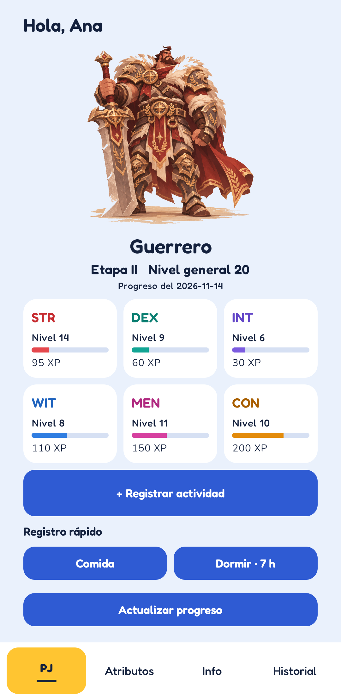

# Lvl Up Life

Una app Android que convierte tus actividades cotidianas en el progreso de un
personaje RPG. Entrenar, estudiar, comer bien o descansar aporta experiencia a
tus atributos y hace evolucionar el nivel, la clase y la apariencia del personaje.

Proyecto para uso personal y pruebas con amigos. La entrega actual es **0.1.2**,
compatible con **Android 10 o posterior**. El APK firmado se distribuye por
separado y se mantiene fuera de este repositorio.



*Captura de prueba con datos sintéticos.*

## Qué podés hacer

- Entrar con Google y crear tu personaje con un nombre de usuario.
- Registrar actividades de hoy, ayer o anteayer, por duración o por ocurrencia.
- Crear actividades personalizadas con sus atributos asociados.
- Consultar los seis atributos: STR, DEX, INT, WIT, MEN y CON.
- Ver el nivel general, la clase y las etapas del personaje.
- Consultar el historial y corregir registros dentro de la ventana permitida.
- Reiniciar la progresión con confirmación explícita, conservando la cuenta,
  el nombre, las actividades personalizadas y el historial.

La XP se calcula a partir de las actividades y sus topes diarios. No se asigna
manualmente. Las reglas completas están en la pestaña **Info** y en el [PRD](PRD.md).

## Cómo usar la app

1. Instalá el APK firmado que te haya compartido el responsable del proyecto.
   Android puede pedir permiso para instalar desde la aplicación que lo abre.
2. Tocá **Continuar con Google** y elegí tu cuenta. Cada persona usa su propia
   cuenta; si todavía no tiene perfil, elige su nombre de usuario.
3. En **PJ**, tocá **+ Registrar actividad**, elegí la fecha y la actividad,
   completá la duración si corresponde y guardá.
4. Consultá **Atributos** para ver el progreso, **Historial** para revisar los
   registros e **Info** para las reglas, las clases y las opciones del personaje.

Al ingresar una duración, podés dejar un componente vacío: `1` hora y Minutos
vacío equivale a una hora; Horas vacío y `30` minutos equivale a media hora.
El total debe ser mayor que cero y no superar 24 horas; Minutos admite de 0 a 59.

Los botones rápidos de PJ registran **una comida saludable** o **7 horas de sueño**
para hoy. Para otra duración o fecha, usá el formulario de registro.

Se necesita Internet para iniciar sesión y confirmar operaciones. Si aparece una
confirmación pendiente, usá el reintento de esa operación: la app conserva su
identificador para resolver el resultado sin duplicarla. No desinstales la app
si tenés operaciones pendientes, porque se perdería su almacenamiento local.

Las actualizaciones firmadas con la misma clave se instalan encima de la versión
release anterior. La app ya incorpora la dirección del servidor: quienes reciben
el APK no necesitan un enlace temporal ni una cuenta de Vercel.

## Cómo está construida

| Parte | Tecnología y responsabilidad |
|---|---|
| App Android | Kotlin y Jetpack Compose para las pantallas; Credential Manager y Firebase Authentication para el ingreso con Google. |
| Almacenamiento local | Room conserva borradores y operaciones pendientes, separados por cuenta. |
| API | Servidor Kotlin/JVM con Ktor: verifica la sesión, ejecuta las operaciones y aplica las reglas de progreso. |
| Persistencia remota | Cloud Firestore guarda cuentas, ciclos, registros, proyecciones y recibos de operaciones. |
| Despliegue de prueba | Vercel ejecuta la API con HTTPS y acceso a Google Cloud mediante federación OIDC limitada, sin claves privadas de servicio en la app. |

La app se comunica con la API y **no accede directamente a Firestore**. El servidor
es necesario para calcular y validar la progresión, aplicar topes, procesar
correcciones y mantener el aislamiento entre cuentas. La identidad de cada
petición proviene del token Firebase verificado, no de un UID elegido por el cliente.

El proyecto separa la interfaz, las reglas de negocio y la persistencia:

| Directorio | Contenido |
|---|---|
| `app/` | Aplicación Android, navegación, repositorios y almacenamiento local. |
| `domain/` | Modelos y reglas deterministas de XP, atributos, niveles, clases y progresión. |
| `server/` | API, casos de uso, autenticación y persistencia en Firestore. |
| `firebase/` | Reglas, configuración de emuladores y comprobaciones de acceso. |
| `deployment/` | Preparación del paquete del servidor para Vercel. |
| `scripts/` | Herramientas de verificación, preparación y firma de entregas. |
| `specs/` y `design/` | Especificaciones, tareas, evidencia y referencias visuales. |

## Cómo se desarrolló

El trabajo parte del [PRD](PRD.md) y sigue una organización con **Spec Kit**:
especificaciones, planes, tareas y verificaciones quedan documentados en el repo.
La [constitución](.specify/memory/constitution.md) fija principios como separar
responsabilidades, centralizar las reglas y proteger los datos de cada cuenta.

Las reglas de dominio se prueban sin Android ni Firebase. La integración del
servidor se comprueba con los emuladores de Firebase y las pantallas con pruebas
Android/Compose. La evidencia distingue pruebas sintéticas de comprobaciones
con cuentas y servicios reales; no todas las pruebas equivalen a uso en un teléfono.

## Compilar para desarrollo

Requisitos: PowerShell 7, JDK 17 y Android SDK con plataforma 37, build-tools y
platform-tools. Para las pruebas con Firebase local también se usa Node.js 22
y las dependencias fijadas en `package-lock.json`. Las versiones de Kotlin,
Compose y otras bibliotecas están en [el catálogo Gradle](gradle/libs.versions.toml).

Desde la raíz del repo, con `JAVA_HOME` y `ANDROID_HOME` configurados:

```powershell
.\gradlew.bat assembleDebug
.\gradlew.bat installDebug
```

El build debug usa por defecto `http://10.0.2.2:8081`, la dirección del equipo
anfitrión desde Android Emulator. No es una dirección para un teléfono físico.
Para usar otra API, reemplazá el origen del siguiente ejemplo por el correspondiente:

```powershell
.\gradlew.bat installDebug "-Plvlup.apiBaseUrl=https://tu-api.example.com"
```

El ingreso Google real requiere `app/google-services.json`, el proveedor habilitado
y las huellas de la firma registradas en el proyecto Firebase compatible con esa
API. El archivo no está versionado; sin él se puede compilar para pruebas, pero
no usar el ingreso Google real. Ver [configuración Android](app/README.md).

Para levantar el servidor y los emuladores con datos sintéticos, seguí la
[guía de ejecución local](specs/001-lvl-up-life-mvp/quickstart.md). Esa guía evita
usar cuentas o credenciales de producción para las pruebas.

## Pruebas

Unitarios de dominio, servidor y Android:

```powershell
.\gradlew.bat :domain:test :server:test :app:testDebugUnitTest
```

Las pruebas de integración y las pruebas Android conectadas requieren su entorno
local preparado. Los comandos y prerrequisitos están en la
[guía de validación](specs/001-lvl-up-life-mvp/quickstart.md).

## Generar un APK para compartir

Para una primera entrega en Windows, creá la firma externa y obtené sus huellas:

```powershell
.\scripts\initialize-android-release-signing.ps1 -JdkPath $env:JAVA_HOME
```

Registrá esas huellas públicas en la app Android de Firebase y descargá su
`google-services.json` actualizado. Con esa configuración y la API HTTPS
disponibles, el siguiente script compila, alinea, firma y verifica el release:

```powershell
.\scripts\build-installable-apk.ps1 `
  -ApiBaseUrl 'https://tu-api.example.com' `
  -OutputDirectory 'C:\APKs\LvlUpLife' `
  -JdkPath $env:JAVA_HOME `
  -AndroidSdkPath $env:ANDROID_HOME
```

Reemplazá la URL de ejemplo por tu API. La salida incluye APK, SHA-256 y metadata,
fuera del repo. La clave de firma se crea o reutiliza en una carpeta privada
separada; hay que conservarla para futuras actualizaciones. Su contraseña usa
DPAPI y depende de la cuenta Windows que la creó: copiarla a otro equipo no
basta para recuperarla. No compartas esa carpeta con el APK.

## Documentación de referencia

- [Especificación funcional](specs/001-lvl-up-life-mvp/spec.md) y [tareas](specs/001-lvl-up-life-mvp/tasks.md).
- [Identidad visual y navegación](specs/002-identidad-visual/spec.md).
- [Preparación del servidor para Vercel](deployment/vercel/README.md).
- [Entrega de la API y APK firmado](specs/001-lvl-up-life-mvp/delivery.md).
- [Ajustes y verificación de la versión 0.1.2](specs/001-lvl-up-life-mvp/ui-feedback.md).

La instancia compartida se preparó en Vercel Hobby y Firebase Spark, sin habilitar
facturación de Google Cloud. Los resultados y límites de esa prueba están en los
registros de entrega; no representan una garantía de disponibilidad permanente.
